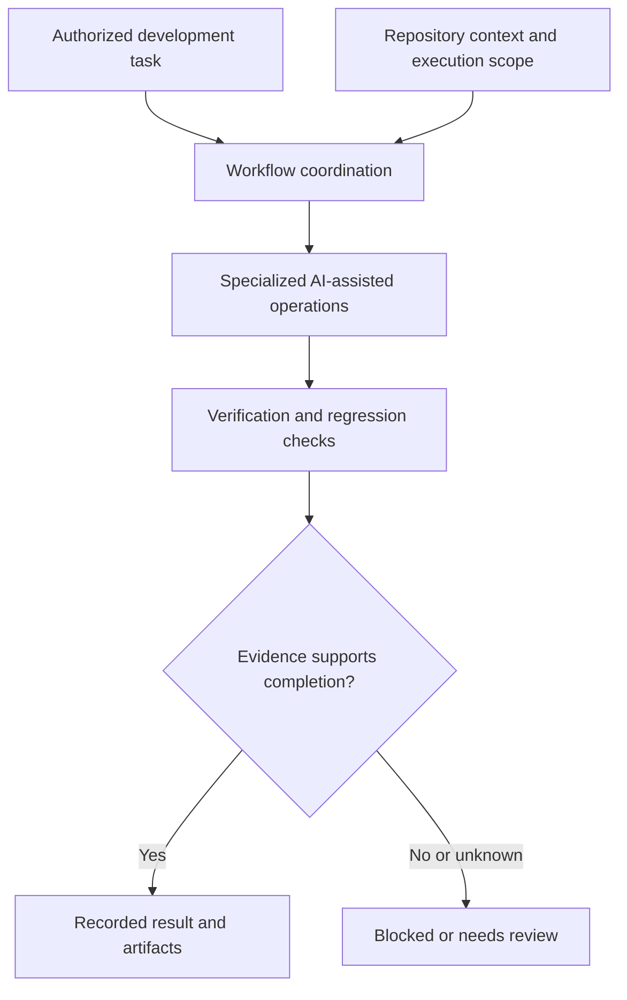

# NEXUS V3

### Engineering reliable multi-agent AI workflows

**Independent engineering project · Active development · Source code private**

NEXUS V3 is an independent software engineering project exploring how AI-assisted development workflows can be coordinated with **explicit execution boundaries, reproducible verification, and auditable evidence**.

The central engineering question is not only *whether an AI agent can complete a task*, but also *how to establish what was executed, within which repository and authority boundaries, and what was actually verified*.

> **Scope of this repository:** This is a technical showcase of the private NEXUS V3 project. It contains no NEXUS V3 runtime code, credentials, private execution artifacts, or proprietary implementation details. The `examples/evidence-gate/` directory is a separately developed educational demonstration using synthetic inputs; it does not reproduce or validate NEXUS V3's private implementation.

## Engineering focus

| Area | Question addressed |
| --- | --- |
| Agent orchestration | How should specialized agents be coordinated within controlled workflows? |
| Execution ownership | Which agent or process is authorized to act, and under what scope? |
| Repository context | How can operations be associated with the intended repository and execution context? |
| Verification | How can test results and independent review inform release decisions? |
| Traceability | What evidence is needed to distinguish a successful execution from a claim of success? |

## System overview

The diagram communicates engineering responsibilities at a high level; it is **not** a complete implementation diagram or an assertion that every illustrated path is production-qualified.

## Verification philosophy

NEXUS V3 emphasizes a distinction between:

- **Execution:** an operation was attempted or completed.
- **Testing:** defined checks were run with recorded outcomes.
- **Independent review:** a separate assessment examined specific evidence or design decisions.
- **Qualification:** a declared set of requirements was met for a *specified scope*.

A passing test suite should not be interpreted as proof that the entire system is defect-free. See [Verification approach](docs/verification.md).

## Project status

**Active development.** Certain engineering milestones have undergone structured tests and reviews; other work remains experimental, under review, or dependent on environment/trust prerequisites. NEXUS V3 is **not presented as production-ready or comprehensively certified**.

A summary of selected historical engineering milestones is available in [Engineering milestones](docs/milestones.md). Original test logs, signed review artifacts, and private execution records are not published. Reported outcomes are limited to their documented scope and do not establish current operational qualification.

## Standalone code demonstration

The [Evidence Gate Demo](examples/evidence-gate/README.md) is a self-contained Python example of deterministic checks on **synthetic** agent execution reports. It compares declared repository context, mandatory checks, and SHA-256 artifact digests, returning `BLOCKED` for inconsistent inputs.

- **Automated tests:** 21/21 Python unit tests passed in [GitHub Actions](.github/workflows/evidence-gate.yml) for this standalone demo.
- **Limits:** The demo checks local input consistency. It does not execute AI agents, authenticate identities, prove the origin of a report, or validate NEXUS V3's private implementation or historical milestones.

The demo was developed separately for this showcase; no private NEXUS V3 source code is included.

## Documentation

- [High-level architecture](docs/architecture.md)
- [Verification and evidence approach](docs/verification.md)
- [Disclosure boundaries](docs/disclosure.md)
- [Engineering milestones and evidence summary](docs/milestones.md)

## About the developer

Developed independently by **Andrea Zannini**, a Biomedical Engineering student at the University of Pisa interested in AI agents, software engineering, and reliable autonomous systems.

## Availability

The NEXUS V3 implementation remains private. This repository is informational; it does not grant access to, or a license for, the underlying private software.
