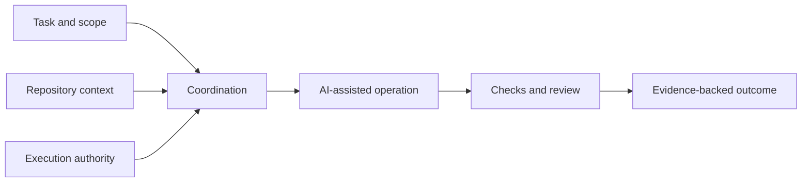

# Architecture — Public Overview

## Purpose

This document explains NEXUS V3's engineering areas without publishing internal architecture, executable code, security-sensitive controls, or implementation-specific interfaces.

## Conceptual responsibilities

1. **Workflow coordination:** define the intended task and arrange steps involving AI-assisted tooling.
2. **Repository context:** keep the intended working repository and execution context explicit.
3. **Execution ownership:** associate controlled operations with a clearly defined responsibility boundary.
4. **Verification:** evaluate defined conditions using tests, checks, and independent review where appropriate.
5. **Evidence and reporting:** preserve enough information to distinguish verified outcomes from unverified claims.

These are conceptual responsibilities rather than a claim that every subsystem is final, integrated, or certified.

## High-level flow

## Out of scope for public documentation

- Internal repository structure and implementation interfaces
- Trust anchors, sensitive security designs, and environment configuration
- Internal operational instructions, credentials, and raw logs
- Unreleased architectural decisions or claims of end-to-end qualification

For the interpretation of testing and reviews, see [Verification](verification.md).
